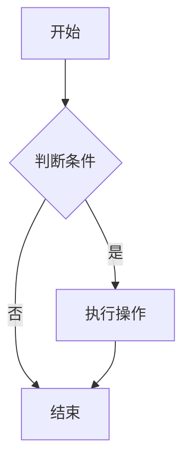

# Markdown 快捷键指南

本文档整理了常用的 Markdown 编辑快捷键，帮助您更高效地编写文档。

## 编辑器通用快捷键

### VS Code 快捷键

| 功能       | Windows/Linux             | Mac                      |
| ---------- | ------------------------- | ------------------------ |
| 加粗       | `Ctrl + B`                | `Cmd + B`                |
| 斜体       | `Ctrl + I`                | `Cmd + I`                |
| 插入链接   | `Ctrl + K`                | `Cmd + K`                |
| 插入图片   | `Ctrl + Shift + I`        | `Cmd + Shift + I`        |
| 切换标题   | `Ctrl + 1/2/3/4/5/6`      | `Cmd + 1/2/3/4/5/6`      |
| 切换预览   | `Ctrl + Shift + V`        | `Cmd + Shift + V`        |
| 侧边预览   | `Ctrl + K V`              | `Cmd + K V`              |
| 插入表格   | `Ctrl + Shift + T`        | `Cmd + Shift + T`        |
| 插入代码块 | ` Ctrl + Shift + ``  ` `` | ` Cmd + Shift + ``  ` `` |

### Typora 快捷键

| 功能     | Windows/Linux        | Mac                 |
| -------- | -------------------- | ------------------- |
| 加粗     | `Ctrl + B`           | `Cmd + B`           |
| 斜体     | `Ctrl + I`           | `Cmd + I`           |
| 下划线   | `Ctrl + U`           | `Cmd + U`           |
| 代码     | ` Ctrl + ``  ` ``    | ` Cmd + ``  ` ``    |
| 标题 1-6 | `Ctrl + 1/2/3/4/5/6` | `Cmd + 1/2/3/4/5/6` |
| 无序列表 | `Ctrl + Shift + ]`   | `Cmd + Shift + ]`   |
| 有序列表 | `Ctrl + Shift + [`   | `Cmd + Shift + [`   |
| 增加缩进 | `Tab`                | `Tab`               |
| 减少缩进 | `Shift + Tab`        | `Shift + Tab`       |

## Markdown 语法快速输入

### 文本格式

| 语法         | 效果         | 快速输入技巧            |
| ------------ | ------------ | ----------------------- |
| `**文本**`   | **粗体**     | 选中文字后按 `Ctrl + B` |
| `*文本*`     | _斜体_       | 选中文字后按 `Ctrl + I` |
| `***文本***` | **_粗斜体_** | `*** + 文本 + ***`      |
| `~~文本~~`   | ~~删除线~~   | `~~ + 文本 + ~~`        |
| `==文本==`   | ==高亮==     | `== + 文本 + ==`        |

### 标题

```markdown
# 一级标题

## 二级标题

### 三级标题

#### 四级标题

##### 五级标题

###### 六级标题
```

**快捷技巧**：在行首输入 `#` + `空格`，按 `Tab` 可以切换标题级别。

### 列表

#### 无序列表

```markdown
- 项目一
- 项目二
  - 子项目 1
  - 子项目 2
- 项目三
```

#### 有序列表

```markdown
1. 第一项
2. 第二项
   1. 子项 1
   2. 子项 2
3. 第三项
```

### 链接和图片

```markdown
[链接文本](URL)


[参考链接][ref]
[ref]: https://example.com
```

### 代码

````markdown
`行内代码`

`代码块`

```javascript
// 指定语言
function hello() {
  console.log("Hello World!");
}
```
````

### 表格

```markdown
| 列 1   | 列 2   | 列 3   |
| ------ | ------ | ------ |
| 内容 1 | 内容 2 | 内容 3 |
| 内容 4 | 内容 5 | 内容 6 |
```

**快捷技巧**：输入 `|列1|列2|列3|` 然后按回车，编辑器会自动生成表格格式。

### 引用

```markdown
> 这是引用文本
>
> > 这是嵌套引用
> >
> > > 这是三级嵌套引用
```

### 分隔线

```markdown
---
---

---
```

### 任务列表

```markdown
- [x] 已完成任务
- [ ] 未完成任务
- [ ] 进行中任务
```

### 脚注

```markdown
这是一个脚注[^1]的例子。

[^1]: 这是脚注的内容
```

## 高效编辑技巧

### 1. 快速格式化

- 选中文字后使用快捷键直接应用格式
- 使用 `Ctrl + Z` 撤销，`Ctrl + Y` 重做

### 2. 列表操作

- 在列表项末尾按 `Enter` 自动创建新列表项
- 按两次 `Enter` 退出列表模式
- 使用 `Tab` 和 `Shift + Tab` 调整列表层级

### 3. 链接快速输入

- 输入 `[` 开始链接，编辑器通常会提示完成
- 粘贴 URL 时自动转换为链接格式

### 4. 表格快速编辑

- 使用 `Tab` 在表格单元格间移动
- 在表格末尾按 `Tab` 自动添加新行

### 5. 代码块智能提示

- 输入 ``` 后选择语言获得语法高亮
- 某些编辑器支持代码自动补全

## 常用编辑器对比

| 编辑器    | 优点                 | 缺点               | 适用场景           |
| --------- | -------------------- | ------------------ | ------------------ |
| VS Code   | 功能强大，插件丰富   | 需要预览窗口       | 开发者，技术文档   |
| Typora    | 所见即所得，界面美观 | 收费（有免费试用） | 写作者，学术文档   |
| Mark Text | 开源免费，实时预览   | 功能相对简单       | 日常笔记，轻量编辑 |
| Obsidian  | 双向链接，知识管理   | 学习成本较高       | 知识库构建         |

## 最佳实践

1. **保持简洁**：不要过度使用格式，保持文档可读性
2. **统一风格**：在一个项目中保持标题层级、列表格式的一致性
3. **合理使用快捷键**：熟练使用快捷键可以大幅提升效率
4. **预览检查**：发布前使用预览功能检查格式效果
5. **备份重要文档**：定期备份重要的 Markdown 文档

## 扩展功能

### GitHub Flavored Markdown (GFM)

- 表格支持
- 任务列表
- 删除线
- 自动链接
- 代码块语法高亮

### Mermaid 图表

````markdown

````

````

### 数学公式
```markdown
行内公式：$E = mc^2$

块级公式：
$$
\sum_{i=1}^{n} i = \frac{n(n+1)}{2}
$$
````

---

> 💡 **提示**：熟练掌握这些快捷键和语法，可以让您的 Markdown 文档编写效率提升数倍。建议在日常使用中逐步掌握这些技巧。
