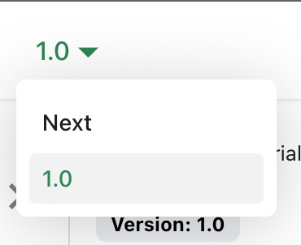

# 开发规范

开发工具及代码风格、模块划分和代码开发规范

## 开发工具

- 统一使用 `VSCode` 编辑器
- 安装 `Prettier` 插件，统一代码格式
- 安装 `ESLint` 插件，统一代码规范


## 模块划分

1. 命名方式

- **文件夹**统一使用-连接，例：`home-page`
- **js/ts/css 文件**统一使用驼峰命名，例：`homePage`
- **组件**以帕斯卡规则命名，例：`HomePage`

2. 模块结构

- 页面入口模块结构需要与路由层级保持一致，入口文件统一命名为 index.vue
- 业务组件统一放到 index.vue 入口文件的同级 `components` 目录下
- 如果需要使用钩子函数，统一放至 `hooks` 目录下，文件名以驼峰规则命名

Modify the `docusaurus.config.js` file:

```js title="docusaurus.config.js"
export default {
  themeConfig: {
    navbar: {
      items: [
        // highlight-start
        {
          type: "docsVersionDropdown",
        },
        // highlight-end
      ],
    },
  },
};
```

The docs version dropdown appears in your navbar:



## Update an existing version

It is possible to edit versioned docs in their respective folder:

- `versioned_docs/version-1.0/hello.md` updates `http://localhost:3000/docs/hello`
- `docs/hello.md` updates `http://localhost:3000/docs/next/hello`
