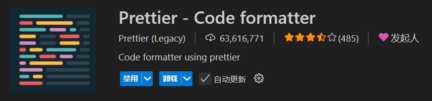
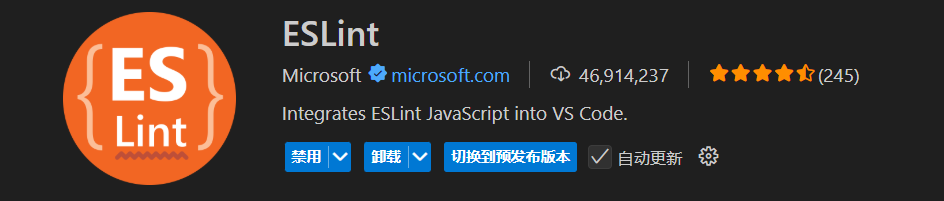

# 开发规范

开发工具及代码风格、模块划分和代码开发规范

## 开发工具

- 统一使用 `VSCode` 编辑器
- 安装 `Prettier` 插件，统一代码格式
- 安装 `ESLint` 插件，统一代码规范





## 命名规范

- **文件夹**统一使用`-`连接，例：`home-page`
- **js/ts/css 文件**统一使用驼峰命名，例：`homePage`
- **组件**以帕斯卡规则命名，例：`HomePage`
- **样式类**统一使用`-`或`_`连接，例：`xxxx-xxxx`, `xxxx_xxx`
- **变量**以小驼峰规则命名，例：`xxxXxxx`
- 非常长的变量名需要加注释

## 模块划分

- 页面`入口模块结构`需要与`路由层级`保持一致，入口文件统一命名为 index.vue
- 业务组件统一放到 index.vue 入口文件的同级 `components` 目录下
- 如果需要使用组合式函数，统一放至 `hooks` 目录下，文件名以驼峰规则命名

```js
  {
    path: '/appGlcFront/account/close',
    name: 'closeLedgerCheck',
    component: () => import('~/pages/account/close/index.vue'),
    meta: {
      title: '关帐检查',
    },
  },
```

```
├── pages
│  ├── account
│  │  ├── close
│  │  │  ├── components
│  │  │  │  ├── CloseAccountForm.vue
│  │  │  │  ├── CloseAccountTable.vue
│  │  │  │  ├── DetailModal.vue
│  │  │  │  └── lov
│  │  │  │    ├── BussinessLov.vue
│  │  │  │    └── PeriodLov.vue
│  │  │  ├── hooks
│  │  │  │  ├── useClose.ts
│  │  │  │  ├── useDayjs.ts
│  │  │  │  └── useDetailModal.ts
│  │  │  ├── index.vue
```
