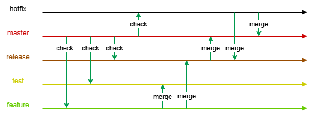

# 项目 Git 分支管理规范

## 推荐学习文档

[菜鸟 Git 教程](https://liaoxuefeng.com/books/git/introduction/index.html)（快速掌握 Git 基础操作）

## 分支流转流程

## 分支概览

| 分支名  | 来源分支 | 核心用途                                                           |
| ------- | -------- | ------------------------------------------------------------------ |
| master  | -        | 线上稳定版本分支                                                   |
| release | master   | 预发布环境分支，所有功能再次通过测试后合并到 master 分支           |
| develop | master   | 日常开发主分支                                                     |
| feature | develop  | 单个迭代功能开发分支，需保证分支干净，不能有其他迭代功能代码       |
| test    | develop  | 集成测试环境分支，分支会随时删除重建，分支内代码不能合并到其他分支 |
| fix     | master   | 线上问题修复分支                                                   |
| hotfix  | master   | 线上问题紧急修复分支                                               |

## 各分支详细说明

### 1. master（主分支）

- **来源**：项目初始化分支（无上游分支）
- **包含内容**：仅**底座代码**（稳定版本）
- **操作规则**：
  - 禁止直接向 master 提交代码

### 2. release（预发布分支）

- **来源**：从`master`签出
- **包含内容**：`底座代码` + `公共组件代码` + `所有已完成的功能代码`
- **操作规则**：
  - 用于预发布环境的最终验证（性能、兼容性等）

### 3. develop（开发分支）

- **来源**：从`master`分支签出
- **包含内容**：`底座代码` + `公共组件代码`
- **操作规则**：
  - 日常开发的主分支，保持可运行状态
  - 所有`feature`分支需从 develop 签出

### 4. feature（特性分支）

- **来源**：从`develop`签出（命名示例：`feature_SAC-0004_20251127`）
- **包含内容**：`底座代码` + `公共组件代码` + `单个功能的业务代码`
- **操作规则**：
  - 命名规范：`feature_XXX_YYMMDD`,其中`XXX`为功能编号或语义化单词，`YYMMDD`为分支创建日期
  - 一个 feature 对应一个独立的迭代功能
  - 开发完成后合并到`test`分支进行测试

### 5. test（测试分支）

- **来源**：从`develop`分支签出
- **包含内容**：`底座代码` + `公共组件代码` + `所有已完成的功能代码`
- **操作规则**：
  - 持续合并已完成的`feature`分支
  - 合并出现冲突时，需手动在 test 分支上解决冲突，绝不可将 test 分支合并到其他分支
  - 用于测试环境部署，供业务人员验证功能

### 6. fix（日常 bug 修复分支）

- **来源**：从`master`签出
- **包含内容**：对应的**修复代码**
- **操作规则**：
  - 修复线上非紧急 bug，按计划测试上线

### 7. hotfix（紧急修复分支）

- **来源**：从`master`签出
- **包含内容**：对应的**紧急修复代码**
- **操作规则**：
  - 修复线上突发问题
